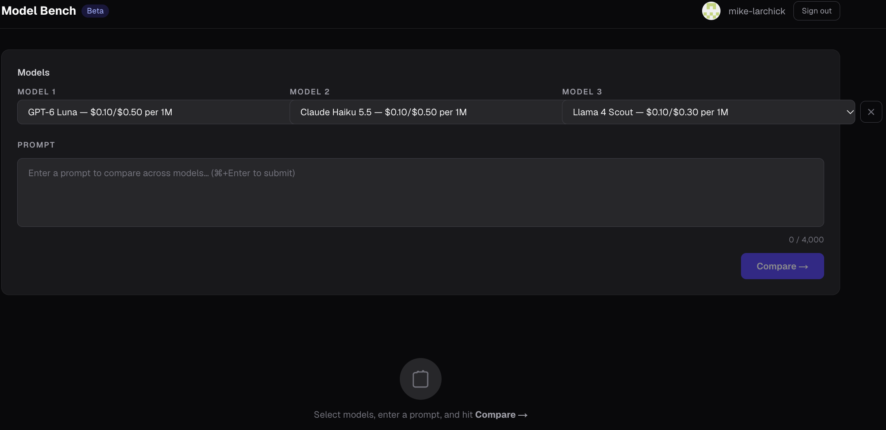
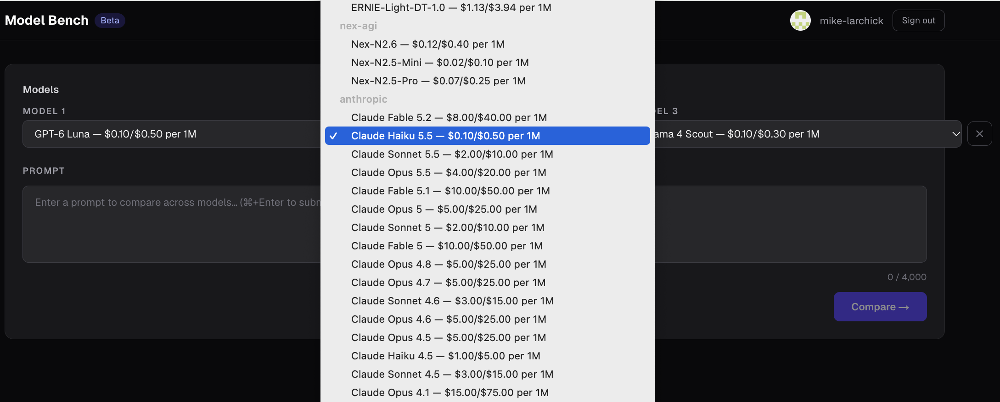
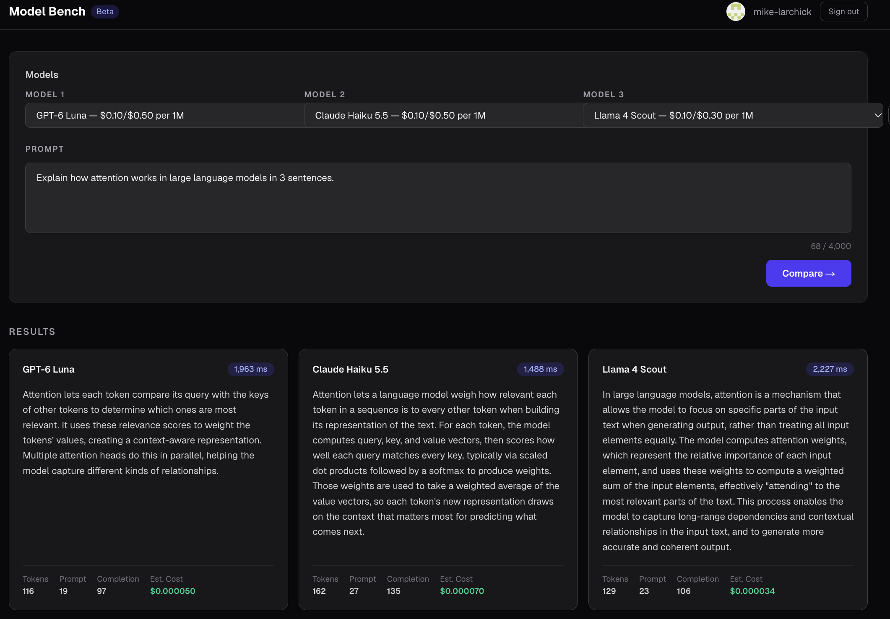

# Model Bench

**Model Bench** is a side-by-side AI model comparison tool built with Next.js and the [OpenRouter](https://openrouter.ai) API. Enter one prompt and compare responses, latency, token usage, and estimated cost across up to three models in a single view.

**[Live demo](https://model-bench-eight.vercel.app)** (sign in with GitHub)



---

## Features

- **Parallel comparison.** One prompt fans out to up to three models at once. Total wait is roughly the slowest model, not the sum.
- **Live model catalog.** The model picker is built from OpenRouter's public models endpoint (cached for an hour, with a curated fallback), so retired models disappear and new ones appear without a code change.
- **Cost visibility.** Each option shows its input/output price per 1M tokens, and each result shows latency, token counts, and an estimated cost from current pricing.
- **Per-model error handling.** If one model fails (retired, out of credits, provider error), its card shows the error and the others still return.
- **Guardrails.** GitHub sign-in is required, the API key stays server-side, and the server enforces request limits (see below).





---

## Tech Stack

- **[Next.js](https://nextjs.org)** (App Router, TypeScript)
- **[Tailwind CSS](https://tailwindcss.com)** (v4, dark theme)
- **[Auth.js / NextAuth.js v5](https://authjs.dev)** with GitHub OAuth
- **[OpenRouter API](https://openrouter.ai/docs)**, a unified API for hundreds of LLMs
- **[Vercel](https://vercel.com)** for deployment

---

## How It Works

```
Browser                    Next.js server                      OpenRouter
  |                              |                                  |
  |-- GET /api/models ---------->|-- GET /api/v1/models (cached) -->|
  |<-- model list + prices ------|<---------------------------------|
  |                              |                                  |
  |-- POST /api/compare -------->|-- POST /chat/completions x N --->|  (parallel)
  |   { prompt, models[] }       |<-- responses + token usage ------|
  |<-- results[] ----------------|                                  |
```

The browser never talks to OpenRouter directly, so the API key never leaves the server.

### Request limits

Every comparison spends real credits, so `/api/compare` enforces these limits (defined in [`lib/limits.ts`](lib/limits.ts) and shared with the UI):

| Limit | Value |
|---|---|
| Models per comparison | 3 |
| Prompt length | 4,000 characters |
| Model IDs | Must exist in the live catalog |
| Duplicate models | Collapsed to one request |
| Output length | 1,024 tokens per response |

---

## Local Setup

### 1. Clone the repo

```bash
git clone https://github.com/mike-larchick/model-bench.git
cd model-bench
```

### 2. Install dependencies

```bash
npm install
```

### 3. Configure environment variables

```bash
cp .env.local.example .env.local
```

Then fill in the values in `.env.local`:

| Variable | Description |
|---|---|
| `OPENROUTER_API_KEY` | Get from [openrouter.ai/keys](https://openrouter.ai/keys). Set a credit limit on the key. |
| `AUTH_SECRET` | Random secret. Run `openssl rand -base64 32` |
| `AUTH_GITHUB_ID` | GitHub OAuth App client ID |
| `AUTH_GITHUB_SECRET` | GitHub OAuth App client secret |
| `NEXT_PUBLIC_APP_URL` | `http://localhost:3000` for local dev |

**Creating a GitHub OAuth App:**
1. Go to GitHub → Settings → Developer settings → OAuth Apps → New OAuth App
2. Set **Authorization callback URL** to `http://localhost:3000/api/auth/callback/github`
3. Copy the Client ID and generate a Client Secret

### 4. Run the dev server

```bash
npm run dev
```

Open [http://localhost:3000](http://localhost:3000) in your browser.

---

## Deploying to Vercel

1. Push the repo to GitHub
2. Import the project at [vercel.com/new](https://vercel.com/new)
3. Add the environment variables from `.env.local.example` in the Vercel project settings (Production). Add `AUTH_TRUST_HOST=true` as well.
4. Create a **separate GitHub OAuth App for production** with the callback URL `https://<your-domain>/api/auth/callback/github`. A GitHub OAuth App allows only one callback URL, so keep the localhost app for local development.
5. Set `NEXT_PUBLIC_APP_URL` to your production URL, then redeploy.

If sign-in fails with *"redirect_uri is not associated with this application"*, the OAuth App's callback URL doesn't exactly match the domain you're visiting.

---

## Project Structure

```
model-bench/
  app/
    page.tsx                  # Landing page with sign-in
    layout.tsx                # Root layout with SessionProvider
    api/
      auth/[...nextauth]/
        route.ts              # Auth.js route handler
      compare/
        route.ts              # POST: validates, then fans out to OpenRouter in parallel
      models/
        route.ts              # GET: live model catalog for the dropdowns
    playground/
      page.tsx                # Auth-protected comparison UI
  components/
    ModelSelector.tsx         # Provider-grouped dropdown with pricing
    PromptInput.tsx           # Textarea, character counter, submit
    ResponseCard.tsx          # Response text, latency, tokens, cost
    ComparisonGrid.tsx        # Lays out the ResponseCards side by side
  lib/
    openrouter.ts             # OpenRouter chat-completions client
    catalog.ts                # Live model catalog (cached, with fallback)
    models.ts                 # Curated fallback list and cost math
    limits.ts                 # Request limits shared by UI and API
  types/
    index.ts                  # Shared TypeScript types
  docs/screenshots/           # README images
  auth.ts                     # Auth.js config (GitHub provider)
  proxy.ts                    # Protects /playground (Next.js 16 proxy)
  .env.local.example          # Required environment variables
```
